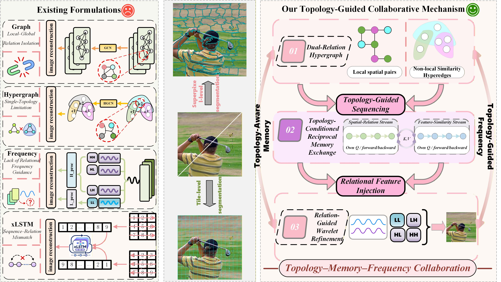
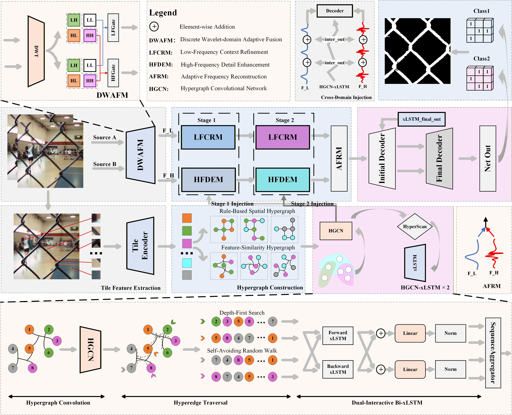
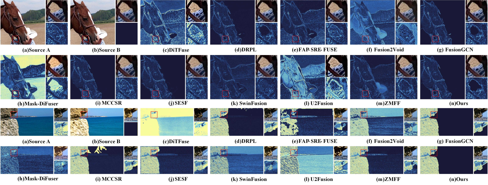
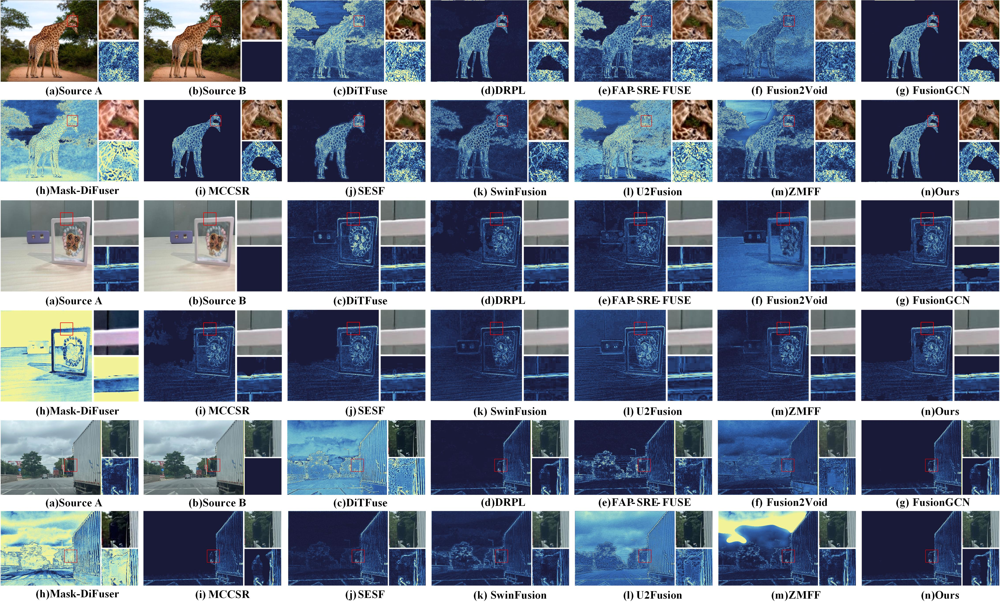

# DRH-xLSTM-Fuse
DRH-xLSTM-Fuse
# Dual-Relation Hypergraph-Guided xLSTM and Adaptive Wavelet-Domain Refinement for Multi-Focus Image Fusion

<div align="center">
    <h3>
        Official implementation of Dual-Relation Hypergraph-Guided xLSTM and Adaptive Wavelet-Domain Refinement for Multi-Focus Image Fusion
    </h3>
</div>
<br>

> This repository contains open-source code for journal peer review. Please do not plagiarize or copy, and adhere to academic ethical standards.
>
> 本仓库为期刊同行评审提供的开源代码。请勿抄袭或复制，并遵守学术道德规范。

**Status: Under Review（在投）**

---

## 🔧 Installation & Requirements

### Environment
This experiment was conducted entirely on the **RTX 3090** GPU. (本实验均在 RTX 3090 GPU 上进行)

-   **OS**: Windows
-   **CUDA** == 12.8
-   **PyTorch** == 2.9.1+cu128
-   **Python** == 3.10 

### Requirements
```txt
einops==0.8.2
networkx==3.4.2
numpy==2.5.5
opencv_contrib_python==4.13.0.92
opencv_python==4.12.0.88
scikit-image==0.0        
thop==0.1.1.post2209072238
timm==1.0.31
torch==2.9.1+cu128
torchmetrics==1.9.0
torchvision==0.24.1+cu128
tqdm==4.65.2
ultralytics_thop==2.2.4
```

**Install dependencies（安装依赖）:**
```shell
pip install -r requirements.txt
```

---

## 📁 File Tree (文件结构)

```text
${PROJECT_ROOT}
    ├── Datasets/Eval     # 评估与测试数据集存放目录 (Dataset directory for evaluation)
    ├── Results           # 融合结果输出目录 (Output directory for fusion results)
    ├──readme_figs        # MD相关图片 (The folder contains the figures for the README document)
    ├── utils             # 工具函数与辅助代码 (Utility functions and helper scripts)
    ├── xlstm_test        # 模型测试相关代码 (Testing scripts and configurations)
    ├── LICENSE           # 开源协议 (License file)
    ├── README.md         # 说明文档 (Readme documentation)
    ├── XLSTM.py          # 核心模型组件代码 (Core model components)
    ├── dataLoader.py     # 数据加载与预处理 (Data loading and preprocessing)
    ├── dwt_function.py   # 离散小波变换相关函数 (Discrete Wavelet Transform functions)
    ├── eval.py           # 图像融合主逻辑 (Main logic for image fusion)
    ├── fusionMD.py       # 核心模型组件代码 (Core model components)
    ├── network.py        # 整体网络结构定义 (Overall network architecture definition)
    ├── r1.py             # 核心模型组件代码 (Core model components)
    └── train.py          # 网络训练脚本 (Script for network training)
```

---

## 🚀 Usage（使用方式）

- `Datasets/Eval` 文件夹中用于存放测试用的多聚焦数据集（如 Lytro、MFFW、MFI-WHU 等）。
  *(The `Datasets/Eval` folder is used to store the multi-focus test datasets.)*

- `Results` 文件夹用于保存模型输出的融合结果图像。
  *(The `Results` folder is used to save the fused result images output by the model.)*

- `train.py` 用于训练网络模型。
  *(Use `train.py` to train the network model.)*

- `eval.py` 用于加载训练好的权重，对不同测试数据集进行推理和融合测试。
  *(Use `eval.py` to load trained weights and perform inference and fusion testing on different test datasets.)*

```shell
# 训练示例 (Training example)
python train.py

# 推理测试示例 (Inference example)
python eval.py

```

---

## 🖼️ Network Architecture

<div align="center">
  
  
</div>

---

## 📊 Results

<div align="center">
  
  <br>
  
</div>
